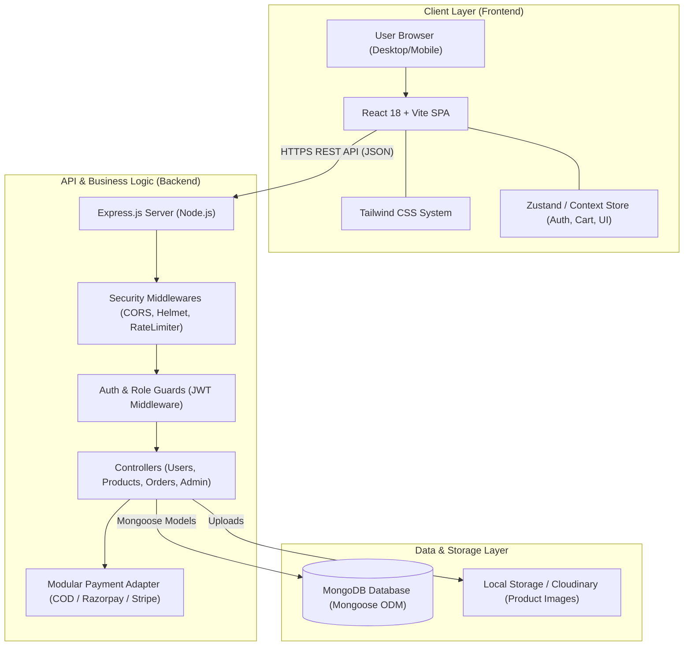
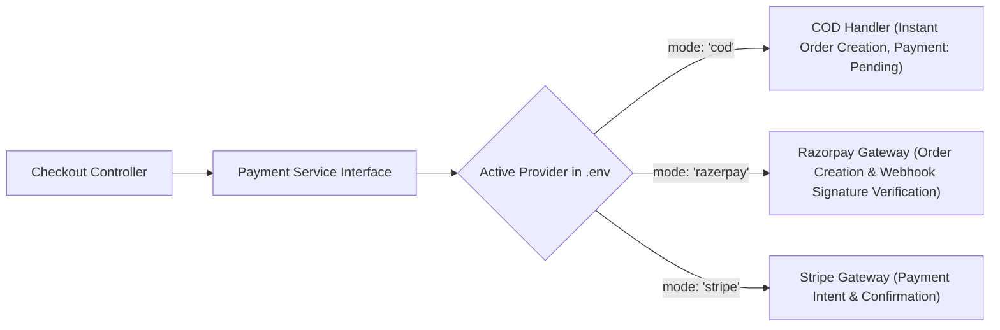
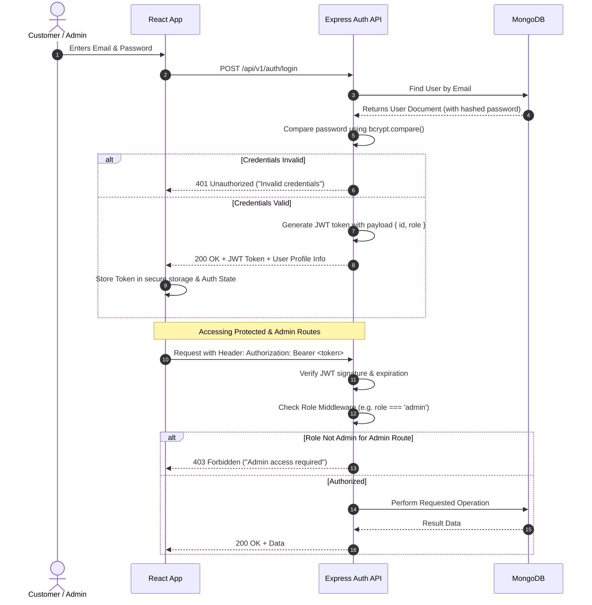
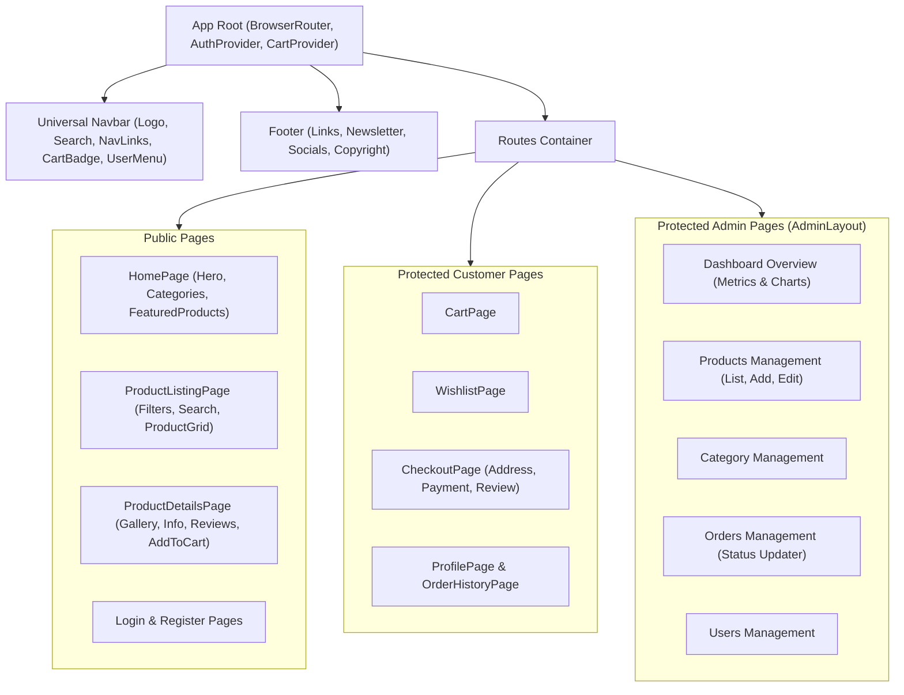

# System Architecture Document
## Project Name: ShopSphere
**Document Version:** 1.0.0  
**Target Stack:** React.js, Tailwind CSS, Node.js, Express.js, MongoDB, Mongoose  

---

## 1. High-Level Architectural Overview

ShopSphere is built using the industry-standard **MERN (MongoDB, Express.js, React.js, Node.js)** architectural pattern following a decoupled, client-server model.

---

## 2. Architectural Layers in Beginner-Friendly Language

### 2.1 The Client Layer (Frontend)
- **Role:** What the user sees and interacts with.
- **Built with:** React 18, Vite (for blazing fast build times), and Tailwind CSS.
- **How it works:**
  - **Single Page Application (SPA):** Instead of reloading the whole page when clicking a link, React instantly swaps out components.
  - **Component-Driven Design:** Buttons, input boxes, product cards, and navigation bars are reusable building blocks.
  - **Global State Management:** Keeps track of who is logged in and what items are in the shopping cart across all pages without losing data on navigation.

### 2.2 The Server Layer (Backend API)
- **Role:** The brain and security guard of the application.
- **Built with:** Node.js runtime and Express.js framework.
- **How it works:**
  - **RESTful Endpoints:** Serves standardized JSON data when requested by the frontend (e.g. `GET /api/v1/products`).
  - **Layered Architecture:**
    1. **Routes:** Directs the incoming URL to the right controller.
    2. **Middlewares:** Checks security, validates user input, and verifies JWT tokens before letting requests reach business logic.
    3. **Controllers:** Handles logic (e.g. checking if stock is available, creating an order).
    4. **Models:** Defines database structure via Mongoose schemas.

### 2.3 The Data Layer (Database)
- **Role:** The permanent vault for your store's data.
- **Built with:** MongoDB (NoSQL Document Store) and Mongoose ODM.
- **How it works:** Data is stored in flexible, JSON-like documents grouped into collections (`users`, `products`, `orders`, `categories`, `reviews`).

---

## 3. Pluggable Payment Adapter Pattern

To accommodate running in **Cash on Delivery (COD)** mode right now while allowing zero-friction switching to **Razorpay** or **Stripe** when deploying to production, ShopSphere employs the **Adapter Pattern**:

### How the Switch Works in Code:
- The system reads an environment variable `PAYMENT_METHOD_DEFAULT=COD`.
- When ready for production deployment:
  1. Add `RAZORPAY_KEY_ID` and `RAZORPAY_KEY_SECRET` to `.env`.
  2. Set `PAYMENT_GATEWAY_ACTIVE=RAZORPAY`.
  3. The checkout UI and backend seamlessly unlock Razorpay popup verification without altering the underlying order or database schema!

---

## 4. Authentication & Authorization Flow

---

## 5. Security Architecture

1. **Password Encryption:**
   - Passwords are never stored in plain text.
   - Hashed using `bcryptjs` with salt rounds = 10 before saving to the database.

2. **Route Protection & Role-Based Access Control (RBAC):**
   - **Public Routes:** Home, Product Catalog, Product Details, Login, Register.
   - **Protected Routes (Customer):** Cart, Wishlist, Checkout, Profile, My Orders.
   - **Admin Protected Routes:** Dashboard, Product CRUD, Category Management, Order Processing, User Management.

3. **Input Sanitization & Validation:**
   - All incoming request bodies are validated using validation schemas (e.g. express-validator / Joi) to reject invalid payloads early.
   - Prevention of NoSQL query injection by casting and sanitizing MongoDB queries.

4. **HTTP Security Headers & CORS:**
   - `helmet` middleware sets secure HTTP headers (X-Content-Type-Options, X-Frame-Options, etc.).
   - `cors` configured to only allow requests from whitelisted frontend origins.

5. **Rate Limiting:**
   - `express-rate-limit` prevents brute-force login attempts and API abuse.

---

## 6. Frontend Routing & Component Hierarchy

