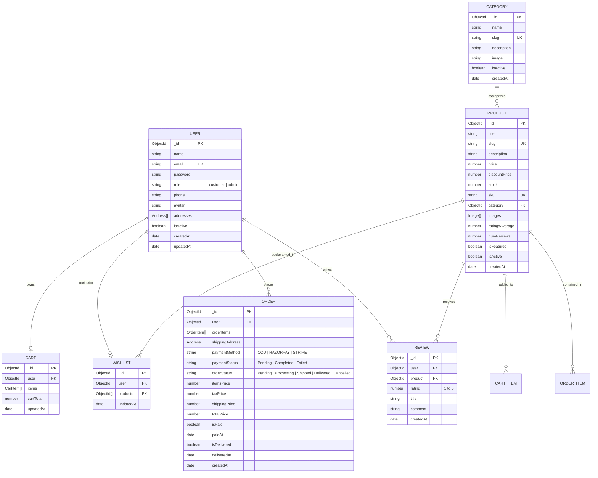

# Database Schema & Data Models Documentation
## Project Name: ShopSphere
**Database Technology:** MongoDB  
**Object Data Modeling (ODM):** Mongoose v8+  

---

## 1. Entity-Relationship Diagram (ERD)



---

## 2. Detailed Mongoose Schema Specifications

### 2.1 User Model (`User.js`)
Stores customer and administrator profile credentials and preferences.

```javascript
const userSchema = new mongoose.Schema(
  {
    name: {
      type: String,
      required: [true, 'Please provide your full name'],
      trim: true,
      maxlength: [50, 'Name cannot exceed 50 characters']
    },
    email: {
      type: String,
      required: [true, 'Please provide an email address'],
      unique: true,
      lowercase: true,
      trim: true,
      match: [/^\S+@\S+\.\S+$/, 'Please provide a valid email address']
    },
    password: {
      type: String,
      required: [true, 'Please provide a password'],
      minlength: [6, 'Password must be at least 6 characters'],
      select: false // Do not return password by default in queries
    },
    role: {
      type: String,
      enum: ['customer', 'admin'],
      default: 'customer'
    },
    phone: {
      type: String,
      trim: true,
      default: ''
    },
    avatar: {
      type: String,
      default: 'https://images.unsplash.com/photo-1534528741775-53994a69daeb?auto=format&fit=crop&q=80&w=200'
    },
    addresses: [
      {
        fullName: { type: String, required: true },
        street: { type: String, required: true },
        city: { type: String, required: true },
        state: { type: String, required: true },
        postalCode: { type: String, required: true },
        country: { type: String, default: 'India' },
        phone: { type: String, required: true },
        isDefault: { type: Boolean, default: false }
      }
    ],
    isActive: {
      type: Boolean,
      default: true
    }
  },
  { timestamps: true }
);

// Indexes
userSchema.index({ email: 1 });
```

---

### 2.2 Category Model (`Category.js`)
Groups products for catalog organization and navigation.

```javascript
const categorySchema = new mongoose.Schema(
  {
    name: {
      type: String,
      required: [true, 'Category name is required'],
      trim: true,
      unique: true,
      maxlength: [60, 'Category name cannot exceed 60 characters']
    },
    slug: {
      type: String,
      required: true,
      unique: true,
      lowercase: true
    },
    description: {
      type: String,
      default: ''
    },
    image: {
      type: String,
      default: ''
    },
    isActive: {
      type: Boolean,
      default: true
    }
  },
  { timestamps: true }
);

// Indexes
categorySchema.index({ slug: 1 });
```

---

### 2.3 Product Model (`Product.js`)
Represents store inventory items with comprehensive specs, pricing, and ratings.

```javascript
const productSchema = new mongoose.Schema(
  {
    title: {
      type: String,
      required: [true, 'Product title is required'],
      trim: true,
      maxlength: [120, 'Title cannot exceed 120 characters']
    },
    slug: {
      type: String,
      required: true,
      unique: true,
      lowercase: true
    },
    description: {
      type: String,
      required: [true, 'Product description is required']
    },
    price: {
      type: Number,
      required: [true, 'Product price is required'],
      min: [0, 'Price must be positive']
    },
    discountPrice: {
      type: Number,
      default: 0,
      validate: {
        validator: function (val) {
          return val <= this.price;
        },
        message: 'Discount price must be less than or equal to regular price'
      }
    },
    stock: {
      type: Number,
      required: [true, 'Stock count is required'],
      min: [0, 'Stock cannot be negative'],
      default: 0
    },
    sku: {
      type: String,
      required: [true, 'SKU is required'],
      unique: true,
      uppercase: true,
      trim: true
    },
    category: {
      type: mongoose.Schema.Types.ObjectId,
      ref: 'Category',
      required: [true, 'Product must belong to a category']
    },
    images: [
      {
        url: { type: String, required: true },
        altText: { type: String, default: '' }
      }
    ],
    ratingsAverage: {
      type: Number,
      default: 0,
      min: [0, 'Rating must be above 0'],
      max: [5, 'Rating must not exceed 5'],
      set: (val) => Math.round(val * 10) / 10
    },
    numReviews: {
      type: Number,
      default: 0
    },
    isFeatured: {
      type: Boolean,
      default: false
    },
    isActive: {
      type: Boolean,
      default: true
    }
  },
  { timestamps: true }
);

// Indexes for fast searching and filtering
productSchema.index({ title: 'text', description: 'text' });
productSchema.index({ category: 1, price: 1, ratingsAverage: -1 });
productSchema.index({ slug: 1 });
```

---

### 2.4 Review Model (`Review.js`)
Contains verified feedback and star ratings given by registered customers.

```javascript
const reviewSchema = new mongoose.Schema(
  {
    user: {
      type: mongoose.Schema.Types.ObjectId,
      ref: 'User',
      required: [true, 'Review must belong to a user']
    },
    product: {
      type: mongoose.Schema.Types.ObjectId,
      ref: 'Product',
      required: [true, 'Review must belong to a product']
    },
    rating: {
      type: Number,
      required: [true, 'Please provide a star rating'],
      min: 1,
      max: 5
    },
    title: {
      type: String,
      trim: true,
      maxlength: [80, 'Review title cannot exceed 80 characters']
    },
    comment: {
      type: String,
      required: [true, 'Please write your review comment']
    }
  },
  { timestamps: true }
);

// Prevent a user from writing multiple reviews for the same product
reviewSchema.index({ user: 1, product: 1 }, { unique: true });
```

---

### 2.5 Cart Model (`Cart.js`)
Maintains server-persisted cart state across devices for authenticated customers.

```javascript
const cartSchema = new mongoose.Schema(
  {
    user: {
      type: mongoose.Schema.Types.ObjectId,
      ref: 'User',
      required: true,
      unique: true
    },
    items: [
      {
        product: {
          type: mongoose.Schema.Types.ObjectId,
          ref: 'Product',
          required: true
        },
        quantity: {
          type: Number,
          required: true,
          min: [1, 'Quantity must be at least 1']
        },
        price: {
          type: Number,
          required: true
        }
      }
    ],
    cartTotal: {
      type: Number,
      default: 0
    }
  },
  { timestamps: true }
);
```

---

### 2.6 Wishlist Model (`Wishlist.js`)
Maintains the list of bookmarked products for a customer.

```javascript
const wishlistSchema = new mongoose.Schema(
  {
    user: {
      type: mongoose.Schema.Types.ObjectId,
      ref: 'User',
      required: true,
      unique: true
    },
    products: [
      {
        type: mongoose.Schema.Types.ObjectId,
        ref: 'Product'
      }
    ]
  },
  { timestamps: true }
);
```

---

### 2.7 Order Model (`Order.js`)
Captures order items, snapshot of shipping address, monetary breakdown, status, and payment details.

```javascript
const orderSchema = new mongoose.Schema(
  {
    user: {
      type: mongoose.Schema.Types.ObjectId,
      ref: 'User',
      required: true
    },
    orderItems: [
      {
        product: {
          type: mongoose.Schema.Types.ObjectId,
          ref: 'Product',
          required: true
        },
        title: { type: String, required: true },
        quantity: { type: Number, required: true },
        image: { type: String, required: true },
        price: { type: Number, required: true }
      }
    ],
    shippingAddress: {
      fullName: { type: String, required: true },
      street: { type: String, required: true },
      city: { type: String, required: true },
      state: { type: String, required: true },
      postalCode: { type: String, required: true },
      country: { type: String, required: true },
      phone: { type: String, required: true }
    },
    paymentMethod: {
      type: String,
      enum: ['COD', 'RAZORPAY', 'STRIPE'],
      default: 'COD'
    },
    paymentStatus: {
      type: String,
      enum: ['Pending', 'Completed', 'Failed'],
      default: 'Pending'
    },
    paymentDetails: {
      transactionId: { type: String },
      gatewayOrderId: { type: String },
      signature: { type: String }
    },
    itemsPrice: {
      type: Number,
      required: true,
      default: 0.0
    },
    taxPrice: {
      type: Number,
      required: true,
      default: 0.0
    },
    shippingPrice: {
      type: Number,
      required: true,
      default: 0.0
    },
    totalPrice: {
      type: Number,
      required: true,
      default: 0.0
    },
    orderStatus: {
      type: String,
      enum: ['Pending', 'Processing', 'Shipped', 'Delivered', 'Cancelled'],
      default: 'Pending'
    },
    isPaid: {
      type: Boolean,
      default: false
    },
    paidAt: {
      type: Date
    },
    isDelivered: {
      type: Boolean,
      default: false
    },
    deliveredAt: {
      type: Date
    }
  },
  { timestamps: true }
);

// Indexes
orderSchema.index({ user: 1, createdAt: -1 });
orderSchema.index({ orderStatus: 1 });
```

---

## 3. Database Indexes & Query Optimizations
1. **Product Search:** Full-text index on `{ title: "text", description: "text" }` empowers instant keyword queries.
2. **Filtering Performance:** Compound index on `{ category: 1, price: 1, ratingsAverage: -1 }` accelerates filtered catalog browsing.
3. **Data Integrity:** Compound unique index on `{ user: 1, product: 1 }` in Reviews guarantees one verified review per customer per product.
4. **Order History:** Index on `{ user: 1, createdAt: -1 }` delivers sub-millisecond retrieval of user order histories.

