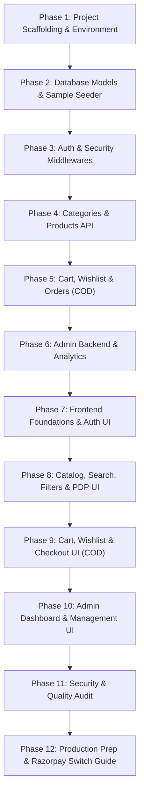

# Step-by-Step Implementation Plan
## Project Name: ShopSphere
**Development Strategy:** Phased Iterative Delivery with Quality Gates  
**Primary Language / Level:** Beginner-Friendly & Production-Ready  

---

## 1. Development Sequence Overview

The implementation of ShopSphere is divided into **12 focused phases**. By building the backend data layer and security first, we ensure that every frontend interface connects directly to rock-solid, validated endpoints.

---

## 2. Granular Phase Breakdown

### Phase 1: Project Scaffolding & Environment Setup
- **Goal:** Create a clean, organized monorepo structure with independent `client` (React + Vite + Tailwind CSS) and `server` (Node.js + Express) packages.
- **Key Tasks:**
  1. Initialize root workspace and Git repository (`.gitignore` for node_modules, .env, uploads).
  2. Setup `server/` with Express, CORS, dotenv, nodemon, helmet, morgan.
  3. Setup `client/` using Vite with React, Tailwind CSS, Lucide React icons, and React Router DOM.
  4. Create root `package.json` with convenience scripts (`npm run dev` to start both client and server concurrently).
- **Security Check:** Ensure `.env` is listed in `.gitignore` so secrets are never pushed to Git.
- **Verification:** Run `npm run dev` and confirm server responds on port 5000 and client renders on port 5173.

---

### Phase 2: Database Schemas & Data Seeder Script
- **Goal:** Establish MongoDB connection and define Mongoose models with validation rules.
- **Key Tasks:**
  1. Setup MongoDB connection module (`server/config/db.js`) with reconnect logic.
  2. Create schemas: `User`, `Category`, `Product`, `Review`, `Cart`, `Wishlist`, `Order`.
  3. Write a database seeder script (`server/seeder.js`) with realistic sample data:
     - 1 Admin account (`admin@shopsphere.com` / `Admin@123`)
     - 2 Demo Customer accounts (`user@shopsphere.com` / `User@123`)
     - 5 Product categories (Electronics, Fashion, Home & Living, Books, Sports)
     - 15+ rich products with images, ratings, and stock.
- **Testing Check:** Run `npm run seed` and verify collections and indexes appear in MongoDB.

---

### Phase 3: Authentication & Security Middlewares
- **Goal:** Implement secure user registration, login, JWT token issuance, and route protection.
- **Key Tasks:**
  1. Build password hashing hook using `bcryptjs` (salt rounds = 10).
  2. Implement JWT token generation utility (`generateToken(userId, role)`).
  3. Implement `protect` middleware to verify Bearer JWT tokens.
  4. Implement `adminOnly` middleware to restrict access to admin-only APIs.
  5. Add input validation rules (valid email format, password length ≥ 6).
  6. Create global error-handling middleware for uniform JSON responses.
- **Security Check:** Confirm that querying protected routes without a token returns `401 Unauthorized`.

---

### Phase 4: Product Catalog & Category REST APIs
- **Goal:** Build high-performance endpoints for product search, filtering, and admin CRUD.
- **Key Tasks:**
  1. Build Category CRUD routes (`GET`, `POST`, `PUT`, `DELETE`).
  2. Build Product listing endpoint with query features:
     - Keyword search on `title` and `description`.
     - Category filter, Price range (`minPrice` / `maxPrice`), Minimum rating filter.
     - Sorting (`price_asc`, `price_desc`, `rating_desc`, `newest`).
     - Pagination (`page`, `limit`).
  3. Build Product Details endpoint (`GET /api/v1/products/:idOrSlug`).
  4. Setup Multer file upload handling for product images (local uploads with public static serving + Cloudinary ready).
  5. Build Admin Product CRUD endpoints.
- **Testing Check:** Use Postman/curl to test multi-facet search queries (e.g. `GET /products?category=electronics&minPrice=1000&sort=price_asc`).

---

### Phase 5: Cart, Wishlist & Order Processing Backend (COD Mode)
- **Goal:** Handle cart state, wishlist persistence, and atomic order creation in Cash on Delivery mode.
- **Key Tasks:**
  1. Build Cart endpoints: Get user cart, add/increment item, update quantity, remove item, clear cart.
  2. Build Wishlist toggle endpoint (`POST /api/v1/wishlist/toggle/:productId`).
  3. Build Order placement endpoint (`POST /api/v1/orders`):
     - Validate product availability and stock counts.
     - Calculate itemsPrice, taxPrice (e.g. 5%), shippingPrice (free over ₹999), and totalPrice.
     - Set `paymentMethod: 'COD'`, `paymentStatus: 'Pending'`, and `orderStatus: 'Processing'`.
     - Decrement product stock in database.
  4. Build Customer Order History endpoint (`GET /api/v1/orders/my-orders`).
- **Security Check:** Verify that a user cannot checkout items that exceed available stock.

---

### Phase 6: Admin Dashboard Backend & Analytics
- **Goal:** Provide analytical insights and order management capabilities for administrators.
- **Key Tasks:**
  1. Build `GET /api/v1/admin/analytics/overview` aggregating:
     - Total revenue (sum of completed orders).
     - Total orders, total customers, total products.
     - List of low-stock products (stock ≤ 5 units).
  2. Build `GET /api/v1/admin/analytics/sales-trend` returning monthly/weekly revenue breakdowns for charts.
  3. Build Admin Order update endpoints:
     - Update order status (`Pending` → `Processing` → `Shipped` → `Delivered` → `Cancelled`).
     - Mark COD order as paid upon delivery (`isPaid: true`, `paidAt: Date`).
  4. Build Admin User management: List all users, toggle active/blocked status.
- **Security Check:** Confirm non-admin users receive `403 Forbidden` on all analytics endpoints.

---

### Phase 7: Customer Frontend Foundation & Navigation
- **Goal:** Build the visual identity, global layouts, and authentication state management.
- **Key Tasks:**
  1. Configure Tailwind CSS with modern theme tokens (colors, fonts, shadows, borders).
  2. Build global state: `AuthContext` (token, user info, login, logout) and `CartContext`.
  3. Build reusable UI components: `Button`, `Input`, `Badge`, `Modal`, `Spinner`, `Toast`.
  4. Build responsive `Navbar`:
     - ShopSphere branding logo.
     - Search bar with instant autocomplete redirect.
     - Category dropdown menu.
     - Wishlist counter pill & Cart counter badge.
     - User profile dropdown (or Login/Register buttons).
  5. Build `Footer` with customer service links, policy links, and newsletter subscription input.
  6. Build `LoginPage` and `RegisterPage` with form validation and error alerts.
- **Verification:** Login as customer, verify token is saved in localStorage, and navbar reflects logged-in state.

---

### Phase 8: Product Catalog, Search, Filters & PDP UI
- **Goal:** Deliver an intuitive, responsive product browsing and discovery experience.
- **Key Tasks:**
  1. Build `HomePage`:
     - Hero banner with CTA ("Shop Now").
     - Category icon pills for quick filtering.
     - Featured Products section & New Arrivals grid.
     - Trust badges (Free Delivery, 7-Day Returns, COD Available).
  2. Build `ProductListingPage`:
     - Sidebar filters (desktop) / Collapsible drawer (mobile): Category checklist, Price slider, Rating stars.
     - Sorting dropdown (Price Low/High, Rating, Newest).
     - Product Card component: Image hover zoom, discount tag, price, star rating, quick Add-to-Cart and Wishlist heart.
     - Pagination controls.
  3. Build `ProductDetailsPage`:
     - Interactive image gallery with thumbnail picker.
     - Price, discount calculation, in-stock badge.
     - Quantity selector with max-stock cap.
     - Tabbed description & customer reviews section.
     - Customer review submission form (with 1-5 star picker).
- **Verification:** Test layout across mobile (375px), tablet (768px), and desktop (1280px).

---

### Phase 9: Cart, Wishlist & Multi-Step Checkout UI (COD Default)
- **Goal:** Allow customers to manage items and complete purchases via Cash on Delivery.
- **Key Tasks:**
  1. Build `CartPage`:
     - List of items with thumbnail, title, price, quantity stepper, and remove icon.
     - Order summary card (Subtotal, Tax, Shipping, Grand Total).
     - Empty cart illustration and "Continue Shopping" button.
  2. Build `WishlistPage` with one-click "Move to Cart".
  3. Build `CheckoutPage` (Multi-Step Wizard):
     - **Step 1:** Select existing shipping address or add a new one.
     - **Step 2:** Payment selection (Highlighting **Cash on Delivery (COD)** with info banner explaining pay-at-doorstep; placeholder for Razorpay card/UPI).
     - **Step 3:** Final order review and "Place Order" button.
  4. Build `OrderSuccessPage`: Displays confirmed Order ID, delivery timeline, and button to view invoice.
  5. Build `ProfilePage` & `OrderHistoryPage`: View past orders with timeline tracker (`Processing` → `Shipped` → `Delivered`).
- **Verification:** Place an order end-to-end; verify cart empties, order appears in Order History, and stock decreases in database.

---

### Phase 10: Admin Dashboard & Management UI
- **Goal:** Build an administrative command center for the store manager.
- **Key Tasks:**
  1. Build `AdminLayout` with dedicated sidebar (Dashboard, Products, Categories, Orders, Users).
  2. Build `DashboardOverviewPage`:
     - KPI Metric Cards (Total Revenue, Total Orders, Customers, Low Stock).
     - Interactive Sales Revenue chart using `Recharts`.
     - Recent orders table with one-click detail view.
  3. Build `AdminProductsPage`:
     - Paginated product list with search and filter.
     - "Add New Product" modal with image preview and category selector.
     - Quick stock inline update & delete action.
  4. Build `AdminCategoriesPage`: Add, edit, and toggle categories.
  5. Build `AdminOrdersPage`:
     - Filter orders by status (`Pending`, `Processing`, `Delivered`).
     - Order Detail modal with status dropdown updater and "Mark as Paid" button for COD orders.
  6. Build `AdminUsersPage`: View all customers and toggle active/blocked.
- **Verification:** Login as admin, create a product, update an order's status to `Shipped`, and see the change reflected on the customer's order tracker.

---

### Phase 11: Security Hardening, Testing & Polish
- **Goal:** Comprehensive QA audit, security verification, and performance optimization.
- **Key Tasks:**
  1. Verify role-based route guards (ensure normal customers cannot access `/admin/*`).
  2. Implement rate limiting on `/api/v1/auth/*` endpoints.
  3. Verify input sanitization and XSS protection.
  4. Verify mobile responsiveness on real device viewports.
  5. Check loading spinners, skeleton screens, and empty states on all pages.

---

### Phase 12: Production Preparation & Razorpay Integration Switch Guide
- **Goal:** Provide straightforward instructions and modular adapters to enable Razorpay in production.
- **Key Tasks:**
  1. Create `paymentService.js` adapter with clean abstraction.
  2. Document exact steps to toggle from `COD` to `RAZORPAY` in `.env`.
  3. Prepare production build scripts (`npm run build`).

